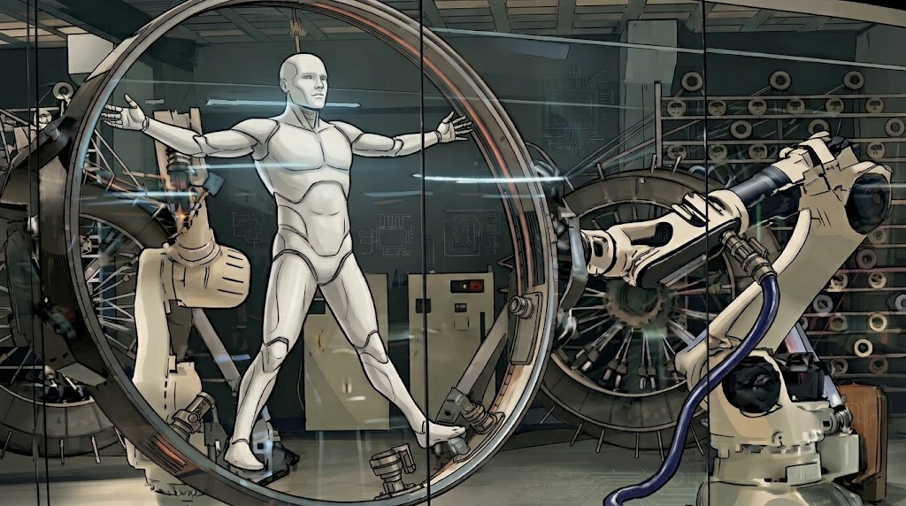
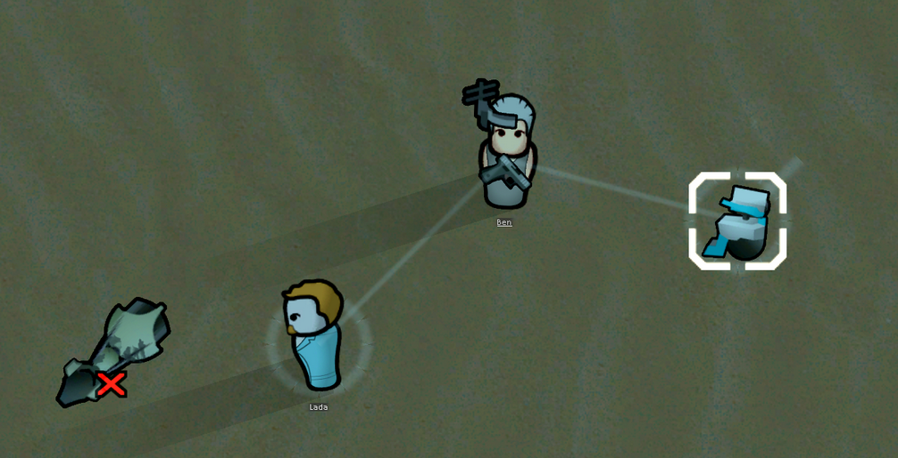
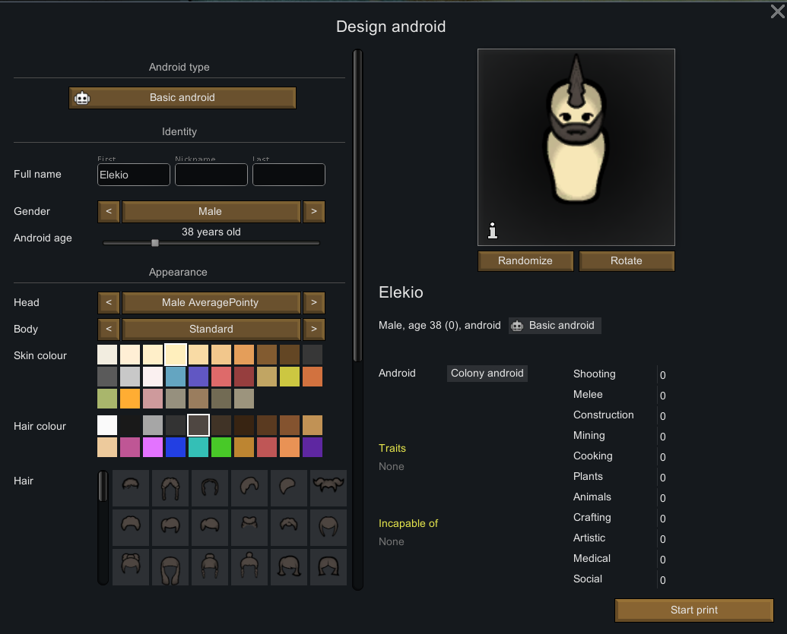

# Vanilla Races Expanded - Android: Machine Overhaul



Machine Overhaul is a patch for Vanilla Races Expanded - Androids that makes androids behave more like mechanoids and adds more options and ease of use around them. Repairs are easier, androids can die and be resurrected, and each one can run on a battery or a reactor of your choice.

The Android Creation Station turns into an assembler with a full body designer. Before a print starts you can customize appearance, hardware and subroutines, then watch the body take shape stage by stage. A new mechanized subroutine lets a mechanitor take oversight of an android, give it work modes and send it out to guard the colony like any of their mechs.

This is an add-on and not a replacement. It needs the original Vanilla Races Expanded - Androids, which it loads after and never redistributes, so keep subscribing to the original.



## Changes

**Damage, repair and death**

* Colonists repair wounds, scars and missing parts on their own, and idle androids get picked up without an order.
* Parts are no longer crafted. The repair job rebuilds whatever was lost, and the parts workbench leaves the build menu.
* Androids can finally be destroyed. A dead body can be resurrected at the assembler for 60 steel and 12 neutroamine, and a subcore can be recovered and reprinted.
* A destroyed android only counts as a body to colonists whose ideoligion sees androids as equals.
* The reactor cannot be hit, injured or broken. The surgery list only offers the reactor instead of an entry for every limb and organ.
* The time until shutdown subroutine gives your crew a couple of hours to get a failing android to safety.

**Hardware**

* Neutroamine, hemogenic and bloodless androids each come with their own circulatory organs.
* Power comes from a reactor or from a battery charged at an Android Stand. The stand no longer short circuits in the rain, and a resting android stands upright on it.
* Memory space is optional hardware that can overheat.
* Sleep, psychic sensitivity and the psylink of awakened androids are reworked, and an awakening always grants a single flame of passion, even with Alpha Skills.

**Assembler and designer**



* Skin, hair, fur, face and body shape are customized before the android is created. Randomize also changes gender and beard.
* Furskin, insectskin and scaleskin show up as components, grouped next to each other.
* Synthetic skin keeps its own faces, and subroutines keep their frame wherever they are listed.
* Hardware is chosen when the body is printed. The Behaviorist Station only reprograms subroutines and restyles appearance.

**New hardware and subroutines**

* Hemogenic gives an android red synthetic blood that passes for organic, refilled with hemogen packs.
* Bloodless androids run completely dry. They never bleed and have nothing to refill.
* Coagulation seals ruptured fluid lines almost instantly.
* Battery powered is a cheaper rechargeable core that drains while working and repairs spend its charge.
* Spacer seals the chassis against vacuum and cold, so no spacesuit is needed.
* Heavy duty is a reinforced chassis made for frontline combat, and delicate frame is its cheap and fragile opposite.
* Hunter seeker adds damage in melee and ranged combat, and dull combat trades it away for a lower power draw.
* Time until shutdown keeps an android fighting for two hours after a critical failure.
* Long jump leaps across great distances and recharges on a cooldown instead of hemogen.
* Sleep cycle makes an android rest like an organic and idle on very little power.
* Gravpilot makes a better gravship and shuttle pilot.
* Ideological lets an android follow an ideoligion and take roles such as leader or moral guide.
* Occultist is the only android that can join psychic rituals and study anomalous entities.
* Mechanized ties the android to a mechanitor.

**Mechanized androids**

* A mechanitor can take oversight, assign control groups and set work modes. Mechanoid Engage Mode and WVC Work Modes are supported.
* On escort the android guards its mechanitor from further away, reacts within half a second and fights with whatever weapon it carries.
* It reconnects to its mechanitor when it is resurrected, and the Assigned mechs tooltip shows its name and charge.

## Requirements

Biotech, Harmony, Vanilla Expanded Framework and Vanilla Races Expanded - Androids. Anomaly, Ideology and Odyssey features are used when those DLCs are present. RimWorld 1.6.

## Installation

Download the zip from the latest release and extract it into your `Mods` folder, or clone this repository there. Load it after Vanilla Races Expanded - Androids.

## Building

The assembly is included in the repository. To rebuild it you need the .NET SDK and a RimWorld install, then point the paths at the top of `1.6/Source/VREAndroidsOverhaul.csproj` at your game and workshop folders and run

```
dotnet build 1.6/Source/VREAndroidsOverhaul.csproj -c Release
```

## Tests

The data files are checked by a small test suite that runs on every push.

```
python3 -m unittest discover tests -v
```

## Credits

Written by och1ai. Vanilla Races Expanded - Androids is by Oskar Potocki, Taranchuk, ISOREX and Sarg Bjornson. The heavy duty and long jump icons are recolored from Biotech artwork.
